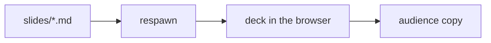

---
title: A slide is a header and a body
kicker: Format_
---

:::: cols tpl="1fr 1fr"
```yaml title="the header"
title: A slide is a header and a body
kicker: Format_
layout: content   # module, part, statement, cover
decks: [workshop] # only in some decks
timer: 5 MIN
notes: What you say, for the notes window.
```
+++
::: list
- "**Markdown** for text: `code`, **bold**, *italic*"
- "`:::` **components** for everything else, `::::` for a container"
- "`+++` splits a `cols` container"
:::
::::

---
title: Cards, steps, flows
kicker: Components_
---

::: cards cols=3
- icon: bolt
  label: Fast
  title: Write in Markdown
  text: The slides build in milliseconds, with live reload while you write.
- icon: terminal
  label: Live
  title: Real terminals
  text: A lab slide opens a shell in the presentation's workspace.
- icon: groups
  label: Together
  title: The room follows
  text: Polls, questions, breaks and exercises on everybody's screen.
:::

---
title: Numbers speak
kicker: Data_
---

:::: cols tpl="1fr 1.4fr"
::: stat big=3x tone=secondary
faster to change than a slide in a GUI tool
:::
+++
::: bars
- [Markdown, 92, 92%]
- [YAML, 64, 64%]
- [HTML, 18, 18%]
:::
::::

---
title: A table and a key-value list
kicker: Data_
decks: [workshop]
---

:::: cols tpl="1fr 1fr"
::: table
headers: [Key, Where, Default]
rows:
  - [title, header, "—"]
  - [layout, header, content]
  - [decks, header, every deck]
:::
+++
::: kv
- [s, the speaker notes window]
- [x, the exercise catalog]
- [q, a poll for the room]
- [j, the QR code to join]
:::
::::

---
title: Code and commands
kicker: Code_
---

```kotlin title="Greeter.kt" size=sm
// a comment stays dim
fun greet(name: String) = "Hello, $name!"
```

```cmd
respawn serve workshop --dev
```

---
title: Diagrams
kicker: Mermaid_
---



---
title: Everything is a component until it is a statement.
kicker: Statement_
layout: statement
lead: A statement slide is one big sentence.
---
